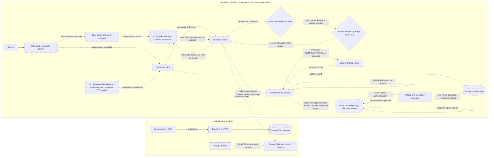

# Architecture as-built et cible MVP

> **Proposition documentaire, non implémentée et non approuvée.** Les traits pleins représentent les composants as-built décrits dans le dépôt. Les traits pointillés représentent la cible MVP CR-001/008/009. Tout accès au collecteur VPS, la couverture fiable, les credentials durables et le budget commun restent `needs-review`.

## Interprétation et frontières

- `background.js` et le backend live sont le comportement as-built; ils ne constituent pas le collecteur VPS CR-008.
- Le refresh token durable est accepté en principe par CR-010, mais le flux OAuth, la protection/rotation des clés, la révocation, les scopes et l'audit restent à concevoir.
- La garde de couverture est fermée tant qu'une méthode fiable pour les réunions courtes et les événements manqués n'est pas démontrée. Le polling à la minute et Workspace Events restent des pistes, pas des garanties.
- Après pagination complète, les identités étudiantes non résolues restent « à vérifier » et le rapport porte un marqueur PARTIEL visible; elles ne sont jamais comptées présentes ou absentes. Le rapport COMPLET ou PARTIEL garde sept colonnes de données.
- Le buffer conserve le rapport final complet ou PARTIEL, son `report_status`, le nombre d'identités à vérifier et son identifiant opaque. Il doit être isolé par mentor, protégé, supprimé à la récupération ou à échéance, et désactivé si le TTL institutionnel manque.
- La finalité institutionnelle et l'absence de frais partagés restent des conditions d'activation. Aucun composant du schéma ne les certifie.
